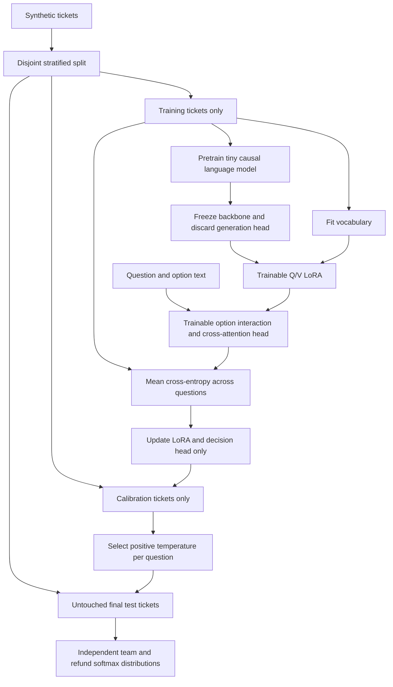

# Decision Head LoRA

Train a model to score predefined choices directly instead of generating an answer token by token. One ticket produces two separate distributions: its support team (`billing`, `technical`, `sales`) and whether the customer requested a refund (`yes`, `no`). These scores support routing experiments without parsing generated prose.

This is a runnable **CPU training laboratory**, with real PyTorch optimization and no model downloads or API keys. A small causal Transformer first learns next-token prediction from synthetic training text. Its original weights then freeze; the generation head is discarded, Q/V LoRA adapters are attached, and a decision head learns to gather evidence for each option. It illustrates the learning mechanism rather than wrapping a hosted classifier.

The backbone is a compact model trained from scratch, **not Qwen3.5 0.8B**, and this project does not reproduce that checkpoint, its training dataset, proprietary architecture, reported accuracy, hardware usage, or runtime. It demonstrates the same broad training boundaries at a scale that can be inspected locally. There is no untested large-model mode.

## How the pieces fit



The state backbone runs once per batch and its token representations are shared by all questions. Frozen question/option token embeddings feed trainable projections. Options interact within their question, then attend to the ticket; one shared scorer emits one logit per option. The head loops over questions, while no autoregressive output generation is used.

Each question gets its own softmax and cross-entropy. The loss is their mean, so the three team options and two refund options never compete in one five-way distribution. Separate normalization does **not** imply the model's errors or decisions are statistically independent.

## Code map

| Source file | Responsibility |
| --- | --- |
| `decision_lora/__init__.py` | Package marker. |
| `decision_lora/data.py` | Defines the two question schemas; generates 384 synthetic tickets with all six label combinations; partitions them by exact example into training/calibration/test; fits vocabulary on training text plus the fixed schema; tokenizes and pads batches. |
| `decision_lora/model.py` | Implements the two-layer causal Transformer, low-rank Q/V updates, replacement decision head, per-question loss and separate softmax. |
| `decision_lora/calibration.py` | Selects one positive temperature per question by minimizing held-out NLL on a finite grid; measures accuracy, NLL and ten-bin ECE. |
| `decision_lora/train.py` | Runs both training phases, verifies frozen weights are unchanged, calibrates using only the calibration split, evaluates the untouched test split, and saves a checkpoint and metrics/split manifest. |
| `decision_lora/predict.py` | Loads that local checkpoint and returns chosen labels with calibrated probabilities for new ticket text. |
| `tests/test_training.py` | Checks split/vocabulary isolation, parameter freezing, LoRA and head gradients, per-question distributions, padding invariance, mean loss and temperature behavior. |
| `requirements.txt` | PyTorch dependency; the test suite uses standard-library `unittest`. |

## Run

Python 3.10+ is required. On PowerShell:

```powershell
python -m venv .venv
.venv\Scripts\Activate.ps1
python -m pip install -r requirements.txt
python -m unittest discover -s tests -v
python -m decision_lora.train --steps 60 --pretrain-steps 60
python -m decision_lora.predict --text "I need help with duplicate charge. Please refund the payment."
```

The same `python -m` commands work on Linux/macOS. CPU training uses two threads and small batches; no GPU is necessary. All inputs are synthetic, generated in memory, and contain no customer records. `--seed` controls the split, initialization and batch sampling. Training prints metrics and writes ignored `artifacts/model.pt` and `artifacts/metrics.json`; use `--output` to choose another directory and pass its model path to inference:

```powershell
python -m decision_lora.train --output C:\Temp\decision-model
python -m decision_lora.predict --checkpoint C:\Temp\decision-model\model.pt
```

Checkpoint loading uses PyTorch's restricted `weights_only=True` loader. Use checkpoints you trained yourself. Inputs longer than 96 tokenizer tokens are rejected explicitly instead of silently truncating evidence.

## Reading the results

- The default split contains 228 training, 72 calibration and 84 test tickets. Exact texts and IDs are disjoint, but phrase components recur across splits. This is a compositional smoke test, not evidence of real support-ticket generalization.
- Vocabulary fitting and language-model pretraining use training data only. Schema words are available by design. Out-of-vocabulary inference words map to `<unk>`.
- The calibration grid covers approximately `0.251` to `3.981` and explicitly includes `1.0`. Temperature is selected independently for each question from detached calibration logits. No backbone or head weights update during calibration.
- Lower held-out NLL is the fitting objective. Calibration-set NLL cannot worsen because `T=1` is available; **test** NLL and ECE can worsen. Accuracy is unchanged by positive temperature scaling because the winning option stays the same.
- Inspect each question's before/after accuracy, uncalibrated/calibrated test NLL, and ECE. Small synthetic splits yield noisy reliability measurements. A high predicted probability does not guarantee correctness, especially on unfamiliar wording.
- The refund question labels an explicit request. It does not determine eligibility or authorize payments. Nothing in this project issues refunds or contacts any service.

## Upstream foundations

- [PyTorch](https://github.com/pytorch/pytorch): tensors, attention and optimization.
- [LoRA reference implementation](https://github.com/microsoft/LoRA) and [the LoRA paper](https://arxiv.org/abs/2106.09685): low-rank trainable updates while base weights remain frozen.
- [Temperature scaling](https://arxiv.org/abs/1706.04599): post-training confidence calibration.
- [Qwen3.5](https://github.com/QwenLM/Qwen3.5): a separate pretrained-model family; no weights or code from it are bundled here.

The model and data code here are standalone implementations of these mechanisms, not a copy of a production decision model.
